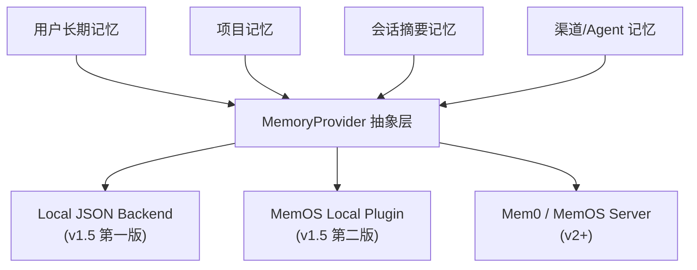
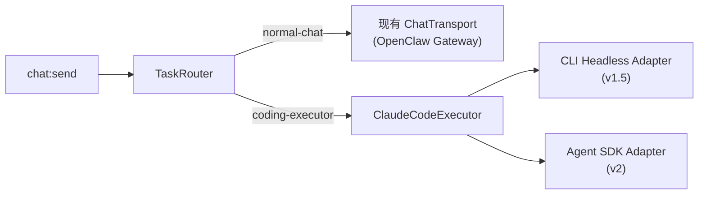

# Mclaw 记忆系统 + Claude Code 接入：综合分析与交付实现方案

> **日期**: 2026-04-23  
> **基于**: 项目代码实际审计 + 官方资料 + 前模型分析交叉验证

---

## 第一部分：结论概要

| 决策项 | 结论 | 理由 |
|--------|------|------|
| MemOS 现在直接接入主线？ | **❌ 不建议** | Python 生态 + Docker 依赖 + 与当前 `2026.3.24` 基线冲突 |
| 先做什么？ | **Mclaw-native memory v1** | 零外部依赖、复用现有 `extraSystemPrompt` 通道、不打断 v1 主线 |
| 记忆后端长期方案？ | **MemOS Local Plugin > Mem0 > MemOS Server** | MemOS 已有 OpenClaw 本地插件 (npm 包)，比 Mem0 更贴合桌面场景 |
| Claude Code 能不能接？ | **✅ 可以，但需要分阶段** | 当前架构已有接入点，但缺 `workspacePath` + 任务路由 |
| Claude Code 第一版怎么做？ | **CLI headless (`-p --output-format stream-json`)** | 最快验证产品链路，不引入新 npm 依赖 |
| Claude Code 长期方案？ | **`@anthropic-ai/claude-agent-sdk`** | 原生 TypeScript、拥有完整的 agent loop 和工具管理 |

---

## 第二部分：MemOS 深度评估

### 2.1 MemOS 是什么

MemOS（Memory Operating System）是 MemTensor 团队维护的开源记忆框架，定位为 LLM/Agent 的"记忆操作系统"。

**核心概念：**

- **MemCube**: 记忆的基本单元，封装内容 + 元数据（来源、版本、治理规则）
- **三类记忆统一抽象**: Plaintext Memory（文本知识）+ Activation Memory（KV-cache）+ Parameter Memory（LoRA 权重）
- **MemScheduler**: 异步记忆调度，支持优先级、自动恢复、配额

**当前状态（截至 2026-04-22）：**

| 维度 | 状态 |
|------|------|
| GitHub Stars | ~8,500 |
| 最新版本 | v2.0 (Stardust, 2025-12-24) |
| OpenClaw 插件 | ✅ 已有 Cloud Plugin + Local Plugin（2026-03-08 发布） |
| 主要语言 | **Python** (poetry + Docker) |
| 部署方式 | Docker Compose / uvicorn CLI (需要 Neo4j + Qdrant) |
| 本地插件 | `@memtensor/memos-local-openclaw-plugin` (npm) — **SQLite + FTS5 + 向量检索** |

### 2.2 MemOS 对 Mclaw 的适配性分析

| 评估维度 | 评分 | 说明 |
|----------|------|------|
| **概念先进性** | ⭐⭐⭐⭐⭐ | 多层记忆统一、生命周期管理、治理能力都很强 |
| **部署复杂度** | ⭐⭐ | 服务端需要 Docker + Neo4j + Qdrant，对桌面产品过重 |
| **语言生态匹配** | ⭐⭐ | MemOS 核心是 Python，Mclaw 是 TypeScript/Electron |
| **本地插件匹配** | ⭐⭐⭐⭐ | Local Plugin 是 npm 包，SQLite 本地存储，**这是最佳切入点** |
| **OpenClaw 版本兼容** | ⭐⭐⭐ | Local Plugin 发布于 2026-03-08，未明确标注最低 OpenClaw 版本 |
| **备份/恢复影响** | ⭐⭐ | 引入新数据目录，影响 [openclaw-restore-service.ts](file:///d:/workspace/Mclaw/electron/main/openclaw-restore-service.ts) 的 scope 定义 |
| **当前项目阶段匹配** | ⭐⭐ | 当前在 Phase 7 安全加固，v1 PRD 明确将 MemOS 列为 v1.5 |

### 2.3 关键风险

> [!WARNING]
> **MemOS 服务端 ≠ MemOS Local Plugin**  
> 前者需要 Python 后端 + Docker 编排，后者是一个纯 npm 包。  
> 对 Mclaw 来说，**只有 Local Plugin 在短期内可行**。

1. **MemOS 服务端完全走 Python 栈**：`pyproject.toml` + `poetry.lock` + Docker，与 Mclaw 的 Electron/TypeScript 栈不兼容
2. **服务端依赖 Neo4j + Qdrant**：对桌面安装包来说是致命负担（参见 [mclaw-prd-v1.md](file:///d:/workspace/Mclaw/docs/mclaw-prd-v1.md) §2.3，明确排除了 Docker 作为 v1 前置依赖）
3. **备份恢复语义冲突**：[dev_guide.md:75](file:///d:/workspace/Mclaw/docs/dev_guide.md#L75) 明确指出 MemOS 上下文记忆能力先按 `2026.4.x` 候选线评估

### 2.4 与其他方案的比较

| 方案 | 语言 | 部署方式 | OpenClaw 集成 | 适合 Mclaw 的阶段 |
|------|------|----------|---------------|-------------------|
| **Mclaw-native memory** | TypeScript | 内置 | 直接复用 extraSystemPrompt | **v1.5 第一阶段** |
| **MemOS Local Plugin** | TypeScript (npm) | OpenClaw 插件安装 | `@memtensor/memos-local-openclaw-plugin` | **v1.5 第二阶段** |
| **Mem0** | Python/Node SDK | 自建服务 / Cloud API | 官方有 OpenClaw 集成文档 | v1.5-v2 |
| **MemOS Server** | Python | Docker Compose | Cloud Plugin | v2+ |
| **Zep/Graphiti** | Python | 自建服务 | 无官方 OpenClaw 插件 | v2+ |
| **Letta** | Python | Docker | 无官方 OpenClaw 插件 | v2+ |

> [!IMPORTANT]
> **我的推荐排序与前模型不同**：  
> 我认为 **MemOS Local Plugin** 应排在 Mem0 前面，因为：
> 1. 它是 npm 包，与 Mclaw 技术栈天然匹配
> 2. 它已有 OpenClaw 插件生态对接
> 3. 它是纯本地 SQLite 存储，符合 Mclaw "本地优先" 定位
> 4. Mem0 的 OpenClaw 集成文档要求 OpenClaw `2026.4.15+`，与当前 `2026.3.24` 基线冲突更大

---

## 第三部分：记忆系统实现方案

### 3.1 四层记忆模型



| 层级 | 内容 | 示例 | 存储粒度 |
|------|------|------|----------|
| **用户长期记忆** | 语言偏好、输出风格、常用工具、固定约束 | "尽量中文回复""Windows 开发""给测试步骤" | 全局 |
| **项目记忆** | repo 技术栈、目录结构、禁改规则、项目约定 | "React + Vite 项目""不要改 config/" | 绑定 workspacePath |
| **会话摘要记忆** | 对话摘要、上次进度、临时上下文 | "上次在修飞书接入bug" | 绑定 sessionId |
| **渠道/Agent 记忆** | 特定渠道/Agent 下生效的记忆 | "飞书群里不要太长回复" | 绑定 agentId + channelId |

### 3.2 数据流设计

```
用户发消息
  ↓
[MemoryRetriever.retrieve(userId, sessionId, workspacePath?)]
  ↓
命中记忆 → 拼成 extraSystemPrompt
  ↓
走现有 ChatTransportRunParams.extraSystemPrompt ← 已有！
  ↓
ChatTransport.run()  ← 无需改动！
  ↓
收到回复
  ↓
[MemoryExtractor.extract(userMessage, assistantReply)]
  ↓
候选记忆 → 自动写入 / 需确认写入
```

**关键发现：当前代码已有完善的 `extraSystemPrompt` 管道**

- [chat-transport-types.ts:23](file:///d:/workspace/Mclaw/electron/main/chat-transport/chat-transport-types.ts#L23): `extraSystemPrompt?: string`
- [cli-chat-transport.ts:347-348](file:///d:/workspace/Mclaw/electron/main/chat-transport/cli-chat-transport.ts#L347-L348): `--append-system-prompt` 参数
- [gateway-streaming-chat-transport.ts:1210-1211](file:///d:/workspace/Mclaw/electron/main/chat-transport/gateway-streaming-chat-transport.ts#L1210-L1211): WebSocket frame 中传递
- [openclaw-chat-service.ts:6777](file:///d:/workspace/Mclaw/electron/main/openclaw-chat-service.ts#L6777): 发送前注入

**这意味着：记忆注入不需要改 transport 层，只需要在 `openclaw-chat-service.ts` 的发送前拼接即可。**

### 3.3 MemoryProvider 抽象接口

```typescript
// electron/main/memory/memory-types.ts

export type MemoryScope = 'user' | 'project' | 'session' | 'channel'

export interface MemoryEntry {
  id: string
  scope: MemoryScope
  content: string
  metadata: {
    userId?: string
    projectPath?: string
    sessionId?: string
    channelId?: string
    agentId?: string
    createdAt: number
    updatedAt: number
    source: 'auto' | 'user-confirmed' | 'manual'
    confidence?: number
  }
  tags?: string[]
}

export interface MemoryRetrieveParams {
  userId?: string
  projectPath?: string
  sessionId?: string
  channelId?: string
  agentId?: string
  query?: string
  scopes?: MemoryScope[]
  maxResults?: number
}

export interface MemoryCommitParams {
  scope: MemoryScope
  content: string
  metadata: Partial<MemoryEntry['metadata']>
  tags?: string[]
  requireConfirmation?: boolean
}

export interface MemoryProvider {
  /** 检索相关记忆 */
  retrieve(params: MemoryRetrieveParams): Promise<MemoryEntry[]>
  
  /** 写入记忆 */
  commit(params: MemoryCommitParams): Promise<MemoryEntry>
  
  /** 生成会话摘要 */
  summarizeSession(sessionId: string, messages: Array<{role: string; text: string}>): Promise<string>
  
  /** 删除记忆 */
  delete(id: string): Promise<boolean>
  
  /** 更新记忆 */
  update(id: string, content: string): Promise<MemoryEntry | null>
  
  /** 列出所有记忆（分页） */
  list(params: { scope?: MemoryScope; offset?: number; limit?: number }): Promise<MemoryEntry[]>
}
```

### 3.4 Local JSON Backend（v1.5 第一版）

```typescript
// electron/main/memory/local-memory-provider.ts

export class LocalMemoryProvider implements MemoryProvider {
  private storePath: string  // ~/.qclaw-lite/memory/memories.json
  
  async retrieve(params: MemoryRetrieveParams): Promise<MemoryEntry[]> {
    // 1. 按 scope 筛选
    // 2. 按 projectPath / sessionId 精确匹配
    // 3. 按 query 做简单关键词匹配（v1 不做 embedding）
    // 4. 按 updatedAt 排序，取 top-N
  }
  
  async commit(params: MemoryCommitParams): Promise<MemoryEntry> {
    // 原子写入，复用现有 atomicWriteJson
  }
  
  // ... 其他方法
}
```

**存储位置**: `path.join(resolveUserDataDirectory(), 'memory', 'memories.json')`  
**复用**: [atomic-write.ts](file:///d:/workspace/Mclaw/electron/main/atomic-write.ts) 的 `atomicWriteJson` 方法

### 3.5 记忆注入位置（发送前）

```typescript
// electron/main/memory/memory-retriever.ts

export async function buildMemoryContext(params: {
  userId: string
  sessionId: string
  messageText: string
  projectPath?: string
  channelId?: string
  agentId?: string
}): Promise<string> {
  const provider = getActiveMemoryProvider()
  const memories = await provider.retrieve({
    userId: params.userId,
    sessionId: params.sessionId,
    projectPath: params.projectPath,
    channelId: params.channelId,
    agentId: params.agentId,
    query: params.messageText,
    maxResults: 10,
  })
  
  if (memories.length === 0) return ''
  
  const sections: string[] = ['## 用户记忆上下文\n']
  
  // 按 scope 分组
  for (const scope of ['user', 'project', 'session', 'channel'] as const) {
    const scopeMemories = memories.filter(m => m.scope === scope)
    if (scopeMemories.length > 0) {
      sections.push(`### ${scopeLabel(scope)}`)
      for (const m of scopeMemories) {
        sections.push(`- ${m.content}`)
      }
    }
  }
  
  return sections.join('\n')
}
```

**接入点**: [openclaw-chat-service.ts:6777](file:///d:/workspace/Mclaw/electron/main/openclaw-chat-service.ts#L6777) 附近  
在构建 `extraSystemPrompt` 时，将记忆上下文拼接到现有的截图引导之后：

```typescript
// 伪代码 - 在 chat service 的发送前
const memoryContext = await buildMemoryContext({
  userId: resolvedUserId,
  sessionId: input.sessionId,
  messageText: input.text,
  projectPath: input.workspacePath,
})

const combinedExtraSystem = [
  screenshotExtraSystemPrompt,  // 现有
  memoryContext,                 // 新增
].filter(Boolean).join('\n\n')
```

### 3.6 记忆抽取（回复后）

```typescript
// electron/main/memory/memory-extractor.ts

export async function extractMemories(params: {
  userMessage: string
  assistantReply: string
  sessionId: string
  projectPath?: string
}): Promise<MemoryCommitParams[]> {
  // 方案 A（v1.5 第一版）：规则匹配
  const candidates: MemoryCommitParams[] = []
  
  // 检测用户偏好声明
  const preferencePatterns = [
    /请?(?:用|以|尽量)(.+?)(?:回复|回答|输出)/,
    /我(?:使用|在|用)(.+?)(?:开发|工作|编程)/,
    /(?:默认|总是|每次)(?:给我|需要)(.+)/,
  ]
  for (const pattern of preferencePatterns) {
    const match = params.userMessage.match(pattern)
    if (match) {
      candidates.push({
        scope: 'user',
        content: match[0],
        metadata: { source: 'auto', confidence: 0.7 },
        requireConfirmation: true,
      })
    }
  }
  
  return candidates
}
```

### 3.7 实施路线总结

| 阶段 | 内容 | 依赖 | 预计工期 |
|------|------|------|----------|
| **Step 1** | `MemoryProvider` 抽象 + 类型定义 | 无 | 1 天 |
| **Step 2** | `LocalMemoryProvider` (JSON 存储) | Step 1 + `atomicWriteJson` | 2 天 |
| **Step 3** | 发送前记忆检索 → `extraSystemPrompt` 注入 | Step 2 | 1 天 |
| **Step 4** | 回复后记忆抽取（规则匹配 v1） | Step 2 | 2 天 |
| **Step 5** | 最小 UI：记忆管理页 + "已记住"提示 | Step 3-4 | 3 天 |
| **Step 6** | `MemOSLocalProvider` (接入 `@memtensor/memos-local-openclaw-plugin`) | Step 1 + OpenClaw 插件生态 | 3-5 天 |

---

## 第四部分：Claude Code 接入分析

### 4.1 当前代码中的接入基础

| 能力 | 现有代码位点 | 状态 |
|------|-------------|------|
| 聊天发送主链 | [openclaw-chat-service.ts](file:///d:/workspace/Mclaw/electron/main/openclaw-chat-service.ts) | ✅ 可插路由 |
| 进程控制/取消 | [command-control.ts:4-18](file:///d:/workspace/Mclaw/electron/main/command-control.ts#L4-L18) | ✅ 已有 domain 体系 |
| 隐藏窗口子进程 | [cli.ts](file:///d:/workspace/Mclaw/electron/main/cli.ts) (1000+ 行) | ✅ 已有 spawn 能力 |
| 外部 worker 参考 | [run-codex-worker.sh](file:///d:/workspace/Mclaw/scripts/run-codex-worker.sh) | ✅ 已有概念验证 |
| `ChatSendRequest` | [chat-panel.ts:197-203](file:///d:/workspace/Mclaw/src/shared/chat-panel.ts#L197-L203) | ⚠️ **缺 `workspacePath`, `taskMode`** |
| `extraSystemPrompt` 管道 | [chat-transport-types.ts:23](file:///d:/workspace/Mclaw/electron/main/chat-transport/chat-transport-types.ts#L23) | ✅ 可用于传递项目上下文 |

### 4.2 Claude Code 两种接入方式对比

| 维度 | CLI Headless | Agent SDK (`@anthropic-ai/claude-agent-sdk`) |
|------|-------------|----------------------------------------------|
| 安装方式 | 系统已有 `claude` CLI | `npm install @anthropic-ai/claude-agent-sdk` |
| 调用方式 | `claude -p "prompt" --output-format stream-json` | `import { query } from '@anthropic-ai/claude-agent-sdk'` |
| 输出解析 | 需要手动 parse JSON stream | 原生 async iterator |
| 配置传递 | `--allowedTools`, `--max-turns`, `--permission-mode` | `{ allowedTools, maxTurns, permissionMode }` |
| 工作目录 | `cwd` 参数 | `cwd` option |
| 适合阶段 | **原型期 / v1.5** | **产品化 / v2** |
| Windows 兼容 | ⚠️ 依赖 WSL / Git Bash | ⚠️ 同样依赖底层 binary |
| 中断/取消 | kill 进程 | 内置 abort 支持 |

### 4.3 任务路由架构



**TaskRouter 判定逻辑：**

```typescript
// electron/main/chat-task-router.ts

export type TaskMode = 'normal-chat' | 'coding-executor'

export interface TaskRouteDecision {
  mode: TaskMode
  confidence: number
  signals: string[]
  requireUserConfirmation: boolean
}

export function routeTask(params: {
  text: string
  sessionOrigin: ChatSessionOrigin
  workspacePath?: string
  claudeCodeAvailable: boolean
}): TaskRouteDecision {
  // 硬性前提条件
  if (params.sessionOrigin !== 'local-direct') {
    return { mode: 'normal-chat', confidence: 1, signals: ['external-channel'], requireUserConfirmation: false }
  }
  if (!params.claudeCodeAvailable) {
    return { mode: 'normal-chat', confidence: 1, signals: ['claude-code-unavailable'], requireUserConfirmation: false }
  }
  if (!params.workspacePath) {
    return { mode: 'normal-chat', confidence: 1, signals: ['no-workspace'], requireUserConfirmation: false }
  }
  
  // 信号检测
  const signals: string[] = []
  const text = params.text.toLowerCase()
  
  // 开发任务关键词
  const codingKeywords = [
    '修改代码', '修复bug', '重构', '写测试', '跑测试', '提交',
    '改文件', '创建文件', '删除文件', '看项目', '分析代码',
    'fix', 'refactor', 'implement', 'debug', 'test', 'commit',
    'create file', 'modify', 'patch',
  ]
  if (codingKeywords.some(kw => text.includes(kw))) {
    signals.push('coding-keyword-match')
  }
  
  // 项目标识检测（在 workspacePath 下）
  const projectMarkers = ['.git', 'package.json', 'pyproject.toml', 'go.mod', 'Cargo.toml']
  // ... fs.existsSync 检测
  
  if (signals.length >= 2) {
    return {
      mode: 'coding-executor',
      confidence: 0.8,
      signals,
      requireUserConfirmation: true,  // 重要：必须用户确认
    }
  }
  
  return { mode: 'normal-chat', confidence: 1, signals: ['no-coding-signal'], requireUserConfirmation: false }
}
```

### 4.4 CodingExecutor 抽象

```typescript
// electron/main/coding/coding-executor-types.ts

export interface CodingExecutorParams {
  prompt: string
  cwd: string
  allowedTools?: string[]
  maxTurns?: number
  permissionMode?: 'auto' | 'default' | 'plan'
  systemPrompt?: string
  signal?: AbortSignal
  onProgress?: (event: CodingProgressEvent) => void
}

export type CodingProgressEvent =
  | { type: 'thinking'; text: string }
  | { type: 'tool-use'; tool: string; input: string }
  | { type: 'tool-result'; tool: string; output: string }
  | { type: 'text-delta'; delta: string; text: string }
  | { type: 'complete'; result: string }
  | { type: 'error'; message: string }

export interface CodingExecutorResult {
  ok: boolean
  result: string
  toolsUsed: string[]
  turnsUsed: number
  durationMs: number
  errorMessage?: string
}

export interface CodingExecutor {
  execute(params: CodingExecutorParams): Promise<CodingExecutorResult>
  isAvailable(): Promise<boolean>
}
```

### 4.5 CLI Headless Adapter（v1.5 第一版）

```typescript
// electron/main/coding/claude-code-cli-executor.ts

import { spawn } from 'node:child_process'

export class ClaudeCodeCliExecutor implements CodingExecutor {
  
  async isAvailable(): Promise<boolean> {
    try {
      // 检查 claude 命令是否可用
      const result = await this.runCommand(['claude', '--version'])
      return result.ok
    } catch {
      return false
    }
  }
  
  async execute(params: CodingExecutorParams): Promise<CodingExecutorResult> {
    const args = [
      'claude',
      '-p', params.prompt,
      '--output-format', 'stream-json',
      '--max-turns', String(params.maxTurns || 10),
    ]
    
    if (params.permissionMode) {
      args.push('--permission-mode', params.permissionMode)
    }
    
    if (params.allowedTools?.length) {
      args.push('--allowedTools', params.allowedTools.join(','))
    }
    
    const proc = spawn(args[0], args.slice(1), {
      cwd: params.cwd,
      env: { ...process.env },
      shell: true,
    })
    
    // 注册到 command-control 以支持取消
    setActiveProcess(proc, 'claude-code')
    
    // Parse stream-json output line by line
    // 每行是一个 JSON 对象，包含 type 字段
    // ...
  }
}
```

### 4.6 环境前置检查（Windows 关键风险）

> [!CAUTION]
> **Anthropic 官方文档对 Windows 的建议是依赖 WSL 或 Git for Windows 环境。**  
> Mclaw 必须在启动 Claude Code 路由前做环境检查。

```typescript
// electron/main/coding/claude-code-env-check.ts

export interface ClaudeCodeEnvStatus {
  cliAvailable: boolean
  cliVersion?: string
  authStatus: 'authenticated' | 'unauthenticated' | 'unknown'
  shellEnvironment: 'powershell' | 'git-bash' | 'wsl' | 'unknown'
  recommendation?: string
}

export async function checkClaudeCodeEnvironment(): Promise<ClaudeCodeEnvStatus> {
  // 1. 检测 claude CLI 是否在 PATH 中
  // 2. 检测认证状态 (claude auth status)
  // 3. 检测 shell 环境
  // 4. 对 Windows 裸 PowerShell 给出警告
}
```

### 4.7 ChatSendRequest 扩展

当前 [ChatSendRequest](file:///d:/workspace/Mclaw/src/shared/chat-panel.ts#L197-L203) 只有 `sessionId`, `text`, `thinking`。需要扩展：

```typescript
// src/shared/chat-panel.ts (修改)

export interface ChatSendRequest {
  sessionId: string
  text: string
  thinking?: ChatThinkingLevel
  // ---- 新增 ----
  mode?: 'normal' | 'coding'          // 任务模式
  workspacePath?: string               // 项目目录
  approvalPolicy?: 'auto' | 'confirm'  // 权限策略
}
```

### 4.8 需要修改的文件清单

| 文件 | 修改内容 | 优先级 |
|------|----------|--------|
| `src/shared/chat-panel.ts` | 扩展 `ChatSendRequest` + 新增 `CodingProgressEvent` 类型 | P0 |
| `electron/main/ipc-handlers.ts` | 透传新字段到 chat service | P0 |
| `electron/main/openclaw-chat-service.ts` | 在 `sendChatMessage` 前加 TaskRouter | P0 |
| `electron/main/command-control.ts` | 增加 `'claude-code'` domain | P1 |
| **新增** `electron/main/coding/coding-executor-types.ts` | 执行器抽象 | P0 |
| **新增** `electron/main/coding/claude-code-cli-executor.ts` | CLI adapter | P0 |
| **新增** `electron/main/coding/claude-code-env-check.ts` | 环境检查 | P0 |
| **新增** `electron/main/chat-task-router.ts` | 任务路由 | P0 |
| **新增** `electron/main/memory/memory-types.ts` | 记忆类型 | P1 |
| **新增** `electron/main/memory/local-memory-provider.ts` | 本地存储 | P1 |
| **新增** `electron/main/memory/memory-retriever.ts` | 检索拼接 | P1 |
| **新增** `electron/main/memory/memory-extractor.ts` | 回复后抽取 | P2 |
| **新增** `electron/main/memory/index.ts` | 统一导出 | P1 |

---

## 第五部分：交付版本实现方案

### 5.1 当前项目阶段判定

基于实际代码和文档审计：

- **Phase 0-4**: ✅ 已完成（文档基线 + Windows 审计 + 双平台 runtime + 产品迁移 + 首启流程）
- **Phase 5**: ✅ 飞书接入闭环已基本完成
- **Phase 6**: 🔄 看门狗模块已有实现，待集成（见 [security-watchdog-integration-plan.md](file:///d:/workspace/Mclaw/docs/security-watchdog-integration-plan.md)）
- **Phase 7**: 🔄 安全模块已有实现，待集成（同上）
- **Phase 8**: ⬜ 双平台发布校验待执行
- **当前 OpenClaw 基线**: `2026.3.24`

### 5.2 v1 交付范围确认（不动）

根据 [mclaw-prd-v1.md:32](file:///d:/workspace/Mclaw/docs/mclaw-prd-v1.md#L32) 和 [mclaw-feature-boundary-matrix.md:38-51](file:///d:/workspace/Mclaw/docs/mclaw-feature-boundary-matrix.md#L38-L51)：

- MemOS / memos 记忆接入 → **v1.5**
- Claude Code 编排接入 → **v1.5**

**结论：v1 主线不受影响。以下方案针对 v1.5 交付。**

### 5.3 v1.5 交付计划

#### Sprint 1：记忆系统 v1（2 周）

| 天数 | 任务 | 产出 |
|------|------|------|
| Day 1 | 创建 `electron/main/memory/` 目录结构 + 类型定义 | `memory-types.ts`, `index.ts` |
| Day 2-3 | 实现 `LocalMemoryProvider` | `local-memory-provider.ts` |
| Day 4 | 实现 `MemoryRetriever` + 接入 `extraSystemPrompt` | `memory-retriever.ts` |
| Day 5-6 | 实现 `MemoryExtractor`（规则匹配 v1） | `memory-extractor.ts` |
| Day 7-8 | 注册 IPC + 最小前端入口（记忆列表 + 编辑/删除） | IPC handlers + React 组件 |
| Day 9-10 | 测试 + 回归验证 + dev_log 更新 | 测试文件 + 文档 |

#### Sprint 2：Claude Code 路由 + 执行器（2 周）

| 天数 | 任务 | 产出 |
|------|------|------|
| Day 1 | 环境检查模块 | `claude-code-env-check.ts` |
| Day 2 | 扩展 `ChatSendRequest` + IPC 透传 | `chat-panel.ts` 修改 |
| Day 3-4 | TaskRouter 实现 | `chat-task-router.ts` |
| Day 5-7 | CLI Headless Executor 实现 + stream-json 解析 | `claude-code-cli-executor.ts` |
| Day 8-9 | 接入 `openclaw-chat-service.ts` 发送链 | chat service 修改 |
| Day 10 | 前端："检测到开发任务" 确认提示 + "执行过程" 折叠展示 | UI 组件 |

#### Sprint 3：集成 + 产品化（1 周）

| 天数 | 任务 | 产出 |
|------|------|------|
| Day 1-2 | 记忆 + Claude Code 联动测试 | E2E 验证 |
| Day 3 | 项目目录选择 UI | DashboardChatPanel 修改 |
| Day 4-5 | 全量回归 + Windows 构建 + smoke | 构建产物 + 测试报告 |

### 5.4 关键设计约束

> [!IMPORTANT]
> 以下设计约束**必须遵守**：

1. **记忆不能破坏现有 transport 层**：只通过 `extraSystemPrompt` 注入，不改 `ChatTransportRunParams` 的核心 schema
2. **Claude Code 不能替代普通聊天**：只在 `local-direct` 会话 + 用户确认 + 有项目目录时才触发
3. **记忆存储不能影响现有备份/恢复**：独立目录 `memory/`，独立于 `chat/transcripts.json`
4. **Claude Code 执行必须可取消**：复用 `command-control.ts` 的 `cancelActiveProcess` 体系
5. **Windows 环境检查必须前置**：不通过则隐藏"开发模式"入口

---

## 第六部分：对前模型回答的交叉验证

| 前模型观点 | 我的验证结论 |
|------------|-------------|
| "先做 Mclaw-native memory v1" | ✅ **完全同意**——代码审计确认 `extraSystemPrompt` 管道已就绪 |
| "Mem0 优先于 MemOS" | ⚠️ **部分不同意**——MemOS Local Plugin 是 npm 包且已有 OpenClaw 插件，比 Mem0 更贴合；Mem0 要求 `2026.4.15+` 版本冲突更大 |
| "ChatSendRequest 缺 workspacePath" | ✅ **已验证**——[chat-panel.ts:197-203](file:///d:/workspace/Mclaw/src/shared/chat-panel.ts#L197-L203) 确实只有 `sessionId/text/thinking` |
| "先 CLI headless 再 SDK" | ✅ **同意**——SDK 包 `@anthropic-ai/claude-agent-sdk` 存在但引入需要评估 native binary 兼容性 |
| "Windows 依赖 WSL/Git Bash" | ✅ **已确认需要环境前置检查** |
| "不要先上 MemOS 服务端" | ✅ **强烈同意**——Python + Docker + Neo4j + Qdrant 与当前 PRD 矛盾 |
| "记忆存储用 `electron.d.ts:1300` 的 memory scope" | ✅ **已核对但需限缩解释**——`src/types/electron.d.ts:1300` 确实存在 `type OpenClawRestoreScope = 'config' | 'memory' | 'all'`，但它描述的是备份/恢复 scope，不等于聊天记忆功能已经实现 |

---

## 第七部分：风险矩阵

| 风险 | 等级 | 缓解措施 |
|------|------|----------|
| Claude Code 在 Windows 裸 PowerShell 不稳定 | 🔴 高 | 环境检查 + 不通过则禁用 |
| 记忆注入 token 爆炸 | 🟡 中 | 限制 `maxResults` + 记忆内容字数上限 |
| 记忆抽取误判（自动写入垃圾记忆） | 🟡 中 | v1 默认 `requireConfirmation: true` |
| MemOS Local Plugin 版本兼容 | 🟡 中 | 先验证与 `2026.3.24` 的兼容性再接入 |
| 记忆影响备份恢复 | 🟡 中 | 独立目录 + 备份 scope 中新增 `memory` |
| Claude Code Auth 过期/失效 | 🟡 中 | 每次执行前检查 auth status |

---

## 附录：参考资料

| 资料 | 来源 |
|------|------|
| MemOS GitHub | https://github.com/MemTensor/MemOS |
| MemOS Local Plugin | https://www.npmjs.com/package/@memtensor/memos-local-openclaw-plugin |
| MemOS Cloud Plugin | https://github.com/MemTensor/MemOS-Cloud-OpenClaw-Plugin |
| Claude Agent SDK (npm) | https://www.npmjs.com/package/@anthropic-ai/claude-agent-sdk |
| Claude Code CLI 用法 | `claude -p "prompt" --output-format stream-json` |
| Mem0 OpenClaw 集成 | https://docs.mem0.ai/integrations/openclaw (要求 `2026.4.15+`) |
| 项目 PRD | [mclaw-prd-v1.md](file:///d:/workspace/Mclaw/docs/mclaw-prd-v1.md) |
| 功能边界矩阵 | [mclaw-feature-boundary-matrix.md](file:///d:/workspace/Mclaw/docs/mclaw-feature-boundary-matrix.md) |
| 版本策略 | [openclaw-version-strategy.md](file:///d:/workspace/Mclaw/docs/openclaw-version-strategy.md) |
| 开发路线图 | [mclaw-development-roadmap.md](file:///d:/workspace/Mclaw/docs/mclaw-development-roadmap.md) |
